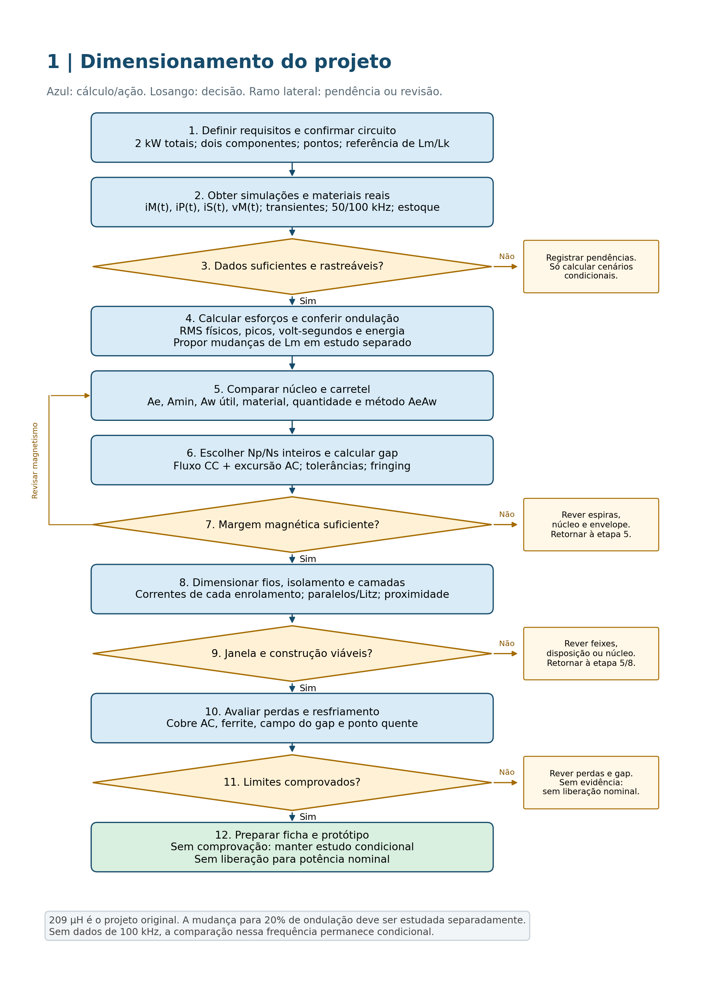
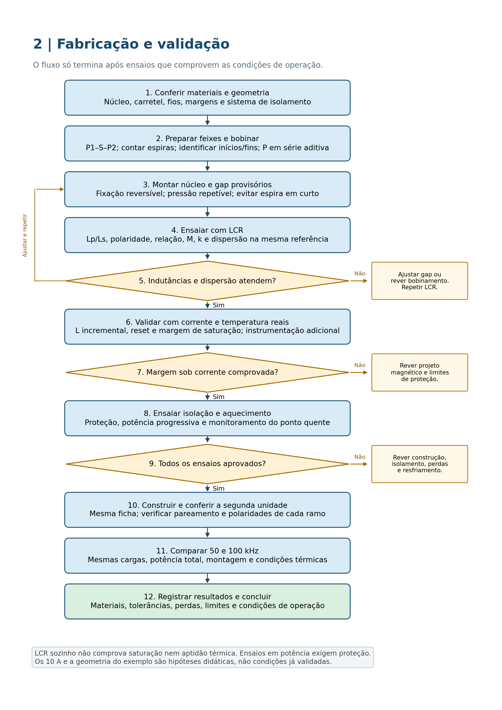
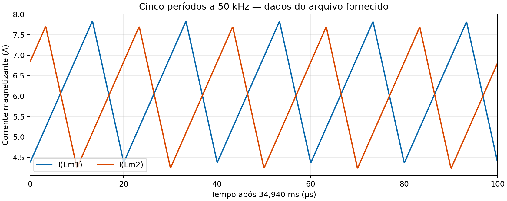
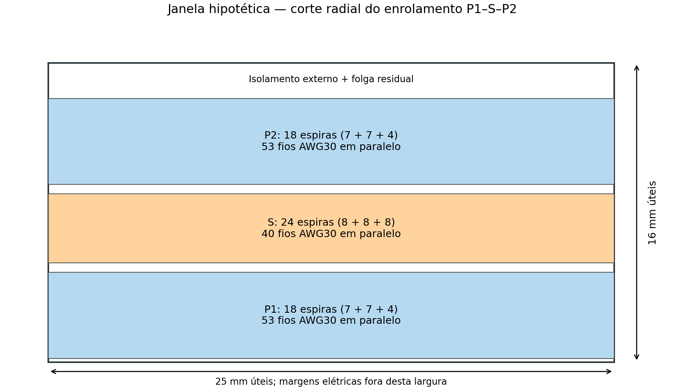
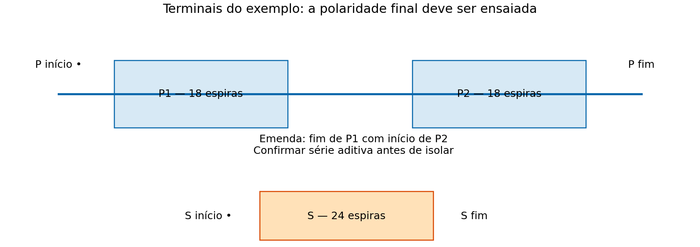

# Guia completo: projeto de indutores acoplados com exemplo e fluxograma

## Como utilizar este documento

Este PDF reúne o procedimento de projeto, um exemplo numérico resolvido e dois fluxogramas. Foi preparado para estudar dois componentes magnéticos idênticos de um conversor CC-CC de 2 kW nas frequências de 50 kHz e 100 kHz.

O objetivo é permitir refazer os cálculos e preparar uma ficha de fabricação. O caso de 50 kHz tem dados numéricos de magnetização verificados. O exemplo de construção utiliza hipóteses explícitas de geometria, correntes físicas e envelope de corrente. **Essas hipóteses não representam um núcleo comercial homologado nem uma liberação para energizar o conversor em potência nominal.**

### Sequência recomendada de leitura

1. Use os fluxogramas para entender a sequência e os retornos de revisão.
2. Leia o método para identificar os dados necessários e a origem das equações.
3. Refaça o exemplo numérico, comparando cada resultado com o código Python.
4. Substitua as hipóteses pelos dados reais do laboratório e da simulação.
5. Execute a validação elétrica, magnética e térmica antes de concluir a fabricação.

### Ficha rápida do exemplo resolvido

| Item | Valor adotado ou calculado | Natureza |
|---|---:|---|
| Lm por componente | 209 µH | Requisito, referência primária a confirmar no modelo |
| Np / Ns | 36 / 24 espiras | Escolha didática, razão 2/3 |
| Arranjo | P1=18, S=24, P2=18 | Primário em série aditiva |
| Correntes físicas RMS P / S | 8 A / 6 A | Hipóteses, não correntes extraídas de iM |
| Envelope de corrente | 10 A | Hipótese de estudo, não transiente medido |
| Ae / Aw | 354 mm² / 400 mm² | Geometria hipotética maior |
| Condutores P / S | 53 / 40 fios AWG30 em paralelo | Exemplo de dimensionamento |
| Gap equivalente inicial | 2,69849 mm | Sem espraiamento; não gap físico aprovado |
| B no envelope e com tolerâncias | 0,181262 T | L+5%, Ae−5%; ainda requer material quente |
| Ocupação geométrica estimada | 0,75188 | Feixes e isolamento hipotéticos |
| Referência de perdas de cobre DC | 4,75776 W | RMS hipotéticos e cobre a 100 °C |

Os dois indutores são unidades separadas, cada uma com P e S. Não confundir Lm1/Lm2 com os dois enrolamentos de um único componente. Não multiplicar a potência total pelo número de referências de saída do barramento.

As perdas AC, de ferrite, a dispersão real e a temperatura final dependem de dados e ensaios ainda pendentes. O orçamento térmico mostrado no exemplo é uma condição de aceitação de estudo, não um resultado experimental.

## Parte 1 — Fluxograma do projeto

### Dimensionamento eletromagnético e térmico

O primeiro fluxo organiza os dados, esforços, seleção, espiras, janela e perdas. Os ramos laterais indicam pendências ou revisões. Se faltar evidência, o estudo continua condicional e não libera fabricação nominal.

{width=95%}

### Construção e validação experimental

O segundo fluxo organiza bobinamento, montagem, LCR, ensaios sob corrente, isolação, aquecimento e comparação de frequências. LCR em pequeno sinal não verifica saturação nominal sozinho.

{width=95%}

## Parte 2 — Como fazer o projeto, passo a passo

### Conversor CC-CC de 2 kW — projetos a 50 kHz e 100 kHz

Este guia explica como transformar o esquema, os resultados de simulação, os dados do núcleo e as condições do laboratório em uma especificação verificável de dois indutores acoplados. O objetivo é permitir que o estudante refaça as contas, escolha os materiais e entenda o que deve medir antes de aplicar a potência nominal.

A especificação inicial é de dois componentes idênticos, cada um com indutância magnetizante de 209 µH e relação Ns/Np próxima de 2/3. Os nomes Lm1 e Lm2 identificam os ramos magnetizantes dos dois componentes. Eles não representam o primário e o secundário de um único componente.

A apresentação segue a metodologia AeAw do `PROJETO_INDUTOR.pdf`, adaptada a dois enrolamentos a partir de fluxo e ocupação de cobre. O arquivo McLyman é uma referência complementar para circuito magnético, entreferro, espraiamento, perdas e utilização da janela.

**Escopo desta edição:** as correntes magnetizantes de 50 kHz foram recalculadas do arquivo recebido. O projeto PSIM completo não pôde ser transferido por exceder 32 MiB. A planilha de estoque, o segundo PDF metodológico e os datasheets dos materiais não foram recebidos ou validados. Portanto, este é um método de projeto com cálculos verificáveis e hipóteses explícitas, e não uma liberação dos componentes para operação nominal.

### 1. Organizar os dados antes de escolher o núcleo

Comece por uma ficha com quatro categorias. Isso evita que um valor usado para ensinar uma conta seja confundido com um resultado da simulação ou uma propriedade de catálogo.

| Categoria | Exemplos deste trabalho | Como usar |
|---|---|---|
| Especificação fornecida | 2 kW, 56 V de entrada, 209 µH, n≈0,667 | Requisito inicial, sujeito à confirmação de referência e condições |
| Resultado verificado | Média e RMS de I(Lm1)/I(Lm2) a 50 kHz | Evidência do ponto simulado, sem representar todo o envelope |
| Hipótese de estudo | Densidade de corrente de 3 A/mm²; geometria didática | Permite calcular alternativas, sem assegurar aprovação |
| Informação pendente | Correntes físicas dos fios, dados oficiais, operação a 100 kHz | Deve ser obtida antes da especificação definitiva |

Registre a origem de cada valor, as unidades e a temperatura associada. Por exemplo, uma resistência a 20 °C não pode ser usada como resistência de operação a 100 °C sem correção.

#### 1.1 O que extrair da simulação

Para cada componente, exporte na mesma base de tempo:

1. Corrente no ramo magnetizante iM(t).
2. Correntes físicas iP(t) e iS(t), com sentido das sondas e dos pontos indicado.
3. Tensões vP(t), vS(t) e, quando acessível, a tensão vM(t) do ramo magnetizante ideal.
4. Comandos das chaves, razão cíclica, defasagem e corrente dos diodos relevantes.
5. Tensões de cada capacitor e correntes de cada carga.
6. Partida, degraus de carga, máxima/mínima entrada e desequilíbrio do barramento bipolar.
7. Limites de proteção, incluindo a corrente máxima antes do desligamento.

Repita esse conjunto a 50 kHz e a 100 kHz. Uma simulação de 100 kHz não consiste somente em reduzir pela metade o eixo do tempo de uma curva de 50 kHz: o controle, as perdas e o modo de condução podem mudar.

#### 1.2 O que obter do estoque

Para cada núcleo, registrar fabricante, código completo, material, quantidade de metades ou pares, dimensões, presença de gap de fábrica e carretel correspondente. Para cada fio, registrar AWG ou diâmetro de cobre, diâmetro externo máximo com esmalte, classe de isolação e metragem.

A identificação “E55/26” de um carretel não confirma seu encaixe em um núcleo “E55/28/25”. É necessário o desenho mecânico. O mesmo cuidado vale para PQ32/20, PQ40/40 e códigos incompletos como B65884E.

### 2. Entender o componente no circuito

O recorte do esquema mostra dois símbolos magnéticos separados, cada qual associado a uma Lm e uma Lk. A interpretação preliminar é de dois conjuntos de ferrite independentes, cada um com dois enrolamentos. Isso resulta em dois núcleos completos e quatro enrolamentos. Não há indicação visível de compartilhamento de uma única estrutura magnética, mas o modelo completo precisa confirmar a interpretação.

Desenhe um símbolo simplificado para cada unidade. Dê aos terminais os nomes P1/P2 e S1/S2 e marque os pontos. A posição à esquerda ou à direita no esquema não determina, por si só, qual lado é o primário de referência.

#### 2.1 Referência e polaridades

Adote tensões medidas do terminal pontuado para o não pontuado. Se ambas as correntes forem definidas entrando nos pontos, no modelo ideal:

`n = Ns/Np`

`vS = n vP`

`iM = iP + n iS`

A contribuição secundária pode compensar parte da força magnetomotriz primária. Se o sentido de uma sonda for invertido, o sinal da expressão muda. Não mude fisicamente o enrolamento para corrigir uma convenção de sonda sem antes conferir o esquema.

A força magnetomotriz resultante e o fluxo são:

`F = Np iP + Ns iS = Np iM`

`Φ = F/Rtotal`

`B = Φ/Ae`

Essas relações explicam por que uma corrente magnetizante de cerca de 6 A pode coexistir com correntes físicas maiores nos fios.

#### 2.2 Equivalente elétrico e magnético

Use no equivalente elétrico um transformador ideal, Lm em paralelo no lado de referência, resistências RP/RS e dispersões LσP/LσS em série. As perdas do ferrite exigem um modelo dependente de forma de onda, frequência, fluxo e temperatura; uma resistência paralela constante serve apenas a uma aproximação local.

No circuito magnético:

`Rtotal = Rcore + Rgap`

`Rcore ≈ le/(μ0 μr Ae)`

`Rgap = Σ gj/(μ0 Agap,efetiva,j)`

A dispersão representa fluxo que não acopla integralmente ambos os enrolamentos. Ela afeta picos de tensão, comutação e circulação de energia; sua energia usa a corrente do enrolamento correspondente.

Para o modo magnetizante linear, a energia é `Wm = 0,5 Lm iM²`. Não some outra vez essa mesma energia como se cada enrolamento tivesse um armazenamento magnetizante independente. Num modelo geral de dois indutores acoplados, a energia é `W = 0,5 Lp iP² + 0,5 Ls iS² ± M iP iS`, com sinais coerentes com os sentidos escolhidos.

### 3. Conferir potência e barramento

Os 340 V podem ser a diferença entre +170 V e −170 V de um mesmo barramento. Isso não produz três saídas independentes de 2 kW.

Se existirem três cargas, uma entre os extremos e duas entre cada extremo e o ponto médio, a potência total fornecida às cargas é:

`Ptotal = 340 I(+−) + 170 I(+0) + 170 I(0−)`

As correntes da expressão são as correntes individuais das cargas, com sinal de consumo. Uma medição que já totalize a potência não deve ser somada novamente.

Como conferência de ordem de grandeza:

`Ientrada,ideal = 2000/56 = 35,714 A`

`Ientrada,real = 2000/(56 η)`

Esse valor não deve ser imposto a iM ou dividido arbitrariamente por dois. A distribuição entre os ramos depende da topologia. Confirmar quais cargas existem, suas potências e o pior desequilíbrio permitido é parte do projeto dos magnéticos.

### 4. Recalcular as correntes do arquivo

Uma curva deve ser analisada em um número inteiro de períodos e, preferencialmente, depois de estabilizar. Para 50 kHz:

`T = 1/f = 20 µs`

O arquivo possui 1.504 amostras, de 34,9178 a 35,0681 ms. Sua duração total é 150,3 µs, equivalente a 7,515 períodos. Usar todo o trecho como se tivesse ciclos completos introduz erro de fase na média e no RMS.

A janela adotada neste estudo é de 34,940 a 35,040 ms, totalizando cinco períodos nominais. As extremidades foram interpoladas e a integração considerou o tempo real.

`Iavg = (1/Δt) integral[i(t) dt]`

`Irms = raiz{(1/Δt) integral[i(t)² dt]}`

`ΔIpp = Imax − Imin`

`ripple(%) = 100 ΔIpp/Iavg`

| Grandeza na janela | Lm1 | Lm2 |
|---|---:|---:|
| Média | 6,099703 A | 5,966345 A |
| RMS magnetizante | 6,180803 A | 6,049461 A |
| Mínimo | 4,373278 A | 4,237980 A |
| Máximo | 7,823397 A | 7,691064 A |
| Pico a pico | 3,450119 A | 3,453084 A |
| Ondulação | 56,5621% | 57,8760% |

O maior pico em todo o arquivo é 7,827687 A no ramo 1. Arredondar para 7,83 A é adequado como referência inicial do ponto observado. Não garante a corrente máxima de partida ou antes da proteção.

Há pequena evolução entre janelas. Antes de usar a simulação como regime permanente definitivo, estender o tempo e conferir se as médias de vários ciclos deixaram de variar.

#### 4.1 Por que essas curvas não dimensionam os fios

Partindo de `iP = iM − n iS`:

`Ip,rms² = Im,rms² + n² Is,rms² − 2n média(iM iS)`

O termo de correlação depende da simultaneidade das curvas. Portanto, nem iM RMS sozinha nem o par de valores RMS de iM e iS determina a corrente primária. Exporte as curvas físicas e calcule diretamente o RMS de cada uma.

### 5. Verificar a ondulação antes de mudar a indutância

Para um modelo magnetizante linear:

`vM = Lm diM/dt`

`ΔiM = integral[vM dt]/Lm`

Pelos dados do ramo 1, um envelope de volt-segundos é:

`Lm ΔIpp = 209 µH × 3,450119 A = 721,075 µV·s`

Os extremos foram obtidos ao longo de cinco períodos; para um cálculo final, integrar cada rampa entre seus próprios extremos e conferir diretamente vM(t).

A derivada numérica sugere patamares de aproximadamente +54,3 V e −108,1 V. Isso é coerente com subida de aproximadamente 13,3 µs e descida de 6,7 µs. Não confirma a razão cíclica de uma chave nem demonstra que a tensão do primário é sempre 56 V.

#### 5.1 Proposta separada para 20%

Se os volt-segundos e as médias permanecessem iguais:

`Lnovo = Latual × ΔIpp,atual/(0,20 Iavg)`

Para o ramo 1:

`Lnovo = 209 × 3,450119/(0,20 × 6,099703) = 591,074 µH`

Para o ramo 2, o resultado é 604,805 µH. Um alvo inicial comum de aproximadamente 605 µH seria uma proposta a simular, não uma alteração automática dos 209 µH.

Uma indutância maior também altera energia armazenada, número de espiras, cobre, resposta do controle e dinâmica de partida. A conta de ripple não fecha o novo projeto sozinha.

#### 5.2 Estudo inicial a 100 kHz

Somente se tensões por estado, frações de período e médias não mudarem:

`ΔIpp,100 = ΔIpp,50/2`

A ondulação seria aproximadamente 28,28% e 28,94%, ainda superior a 20%. Isso é uma extrapolação, não uma simulação de 100 kHz.

Para comparar frequências, mantenha primeiro o requisito original de 209 µH e registre o que muda nas curvas reais. Se decidir avaliar uma segunda indutância, trate-a como variante adicional, com nova memória de cálculo.

### 6. Calcular fluxo, energia e a condição mais severa

A tensão controla a variação de fluxo:

`vM = Np Ae dB/dt`

`ΔB = integral[vM dt]/(Np Ae)`

No modelo linear, sem remanência inicial relevante:

`B ≈ Lm iM/(Np Ae)`

Assim, há duas verificações complementares: os volt-segundos definem a excursão; a corrente magnetizante e a indutância definem o nível de fluxo, incluindo a componente CC.

A frequência maior pode reduzir a excursão AC, mas não elimina o fluxo causado pela polarização CC:

`Bdc ≈ Lm Idc/(Np Ae)`

Não reduza Np pela metade apenas porque f dobrou. Com Lm e Idc mantidos, isso dobraria Bdc.

A energia de referência inicial é:

`Wm = 0,5 × 209 × 10^−6 × 7,83² = 6,40678 mJ`

O gap deve permitir armazenar essa energia com o fluxo escolhido. Aproximadamente, quando o gap domina a relutância, sua energia é `Wgap ≈ B² Agap g/(2 μ0)`. O resultado deve ser coerente com a energia calculada por L e corrente.

#### 6.1 Definir limite de fluxo

Escolha Blim usando simultaneamente:

- Saturação mínima do material na temperatura máxima prevista.
- Perdas de núcleo na frequência e na excursão de operação.
- Fluxo adicional de partida, desequilíbrio e tolerâncias.
- Margem contra variações de montagem e área mínima da seção.

Uma meta didática de 0,20 T pode iniciar uma comparação. Ela não é o Bsat validado de N87 ou N97. As sugestões de 0,3–0,35 T da aula também não são autorização para trabalhar nesse nível em qualquer frequência e temperatura.

Use Ae efetivo para a transformação média entre fluxo e densidade; quando houver uma seção mínima menor que Ae, confira o fluxo local também com Amin. Bsat deve ser comparado à condição local e quente, e não somente à média nominal do caminho.

### 7. Aplicar AeAw a dois enrolamentos

O método faz duas exigências caberem no mesmo componente: área de núcleo suficiente para o fluxo e área de janela suficiente para o cobre.

Defina:

- Ae: seção magnética efetiva, m².
- Aw: janela de enrolamento conforme a convenção do núcleo/carretel, m².
- Lm: indutância magnetizante referida ao primário, H.
- IMpk: pico magnetizante de projeto, A.
- Ip,rms e Is,rms: correntes físicas dos dois enrolamentos, A.
- J: densidade de corrente no cobre, A/m².
- ku: fração total de cobre nu utilizável na janela, sem unidade.
- n: Ns/Np, sem unidade.

Evite um erro de fator dois: confira se Aw do catálogo é a área de uma janela lateral ou outra convenção geométrica. Uma volta ocupa os dois lados do carretel; usar a soma das duas janelas com uma fórmula definida para uma janela conta espaço duas vezes.

#### 7.1 Derivação

A exigência de fluxo fornece:

`Np >= Lm IMpk/(Ae Blim)`

A exigência de cobre fornece:

`Aw ku >= Np AcuP + Ns AcuS`

Com `AcuP >= Ip,rms/J`, `AcuS >= Is,rms/J` e `Ns = n Np`:

`Aw ku >= Np (Ip,rms + n Is,rms)/J`

Substituindo o limite de Np:

`Ae Aw >= Lm IMpk (Ip,rms + n Is,rms)/(Blim J ku)`

Essa derivação usa a função física do indutor acoplado; não depende das relações de ganho ou potência de um Flyback.

Se as densidades de corrente forem diferentes, use:

`Ae Aw >= (Lm IMpk/Blim) × [Ip,rms/(Jp ku) + n Is,rms/(Js ku)]`

O ku continua representando a fração total de cobre utilizável; não aplique uma segunda penalização idêntica pelo número de enrolamentos.

#### 7.2 Unidades e substituição

Em SI, o resultado é m^4. Para converter para cm^4, multiplicar por 10^8.

Com Lm=209 µH, IMpk=7,83 A, Blim=0,20 T, J=3 A/mm²=3×10^6 A/m² e ku=0,25:

`AeAw_req = 1,09098 × (Ip,rms + 0,666667 Is,rms) cm^4`

O valor final depende dos RMS físicos. Se apenas para ilustrar a substituição forem usados 8 A e 6 A:

`AeAw_req = 1,09098 × (8 + 0,666667 × 6) = 13,0918 cm^4`

Esses 8/6 A não são valores extraídos do PSIM.

### 8. Escolher núcleo e carretel

Construa uma tabela de candidatos com Ae, Amin, Aw útil, le, Ve, AL, material, gap, perdas e estoque. Os candidatos informados pelo usuário são PQ40/40 N97, E42/21/20 N87OL, E55/28/25 N87OL e PQ32/20 N87. Confirmar a grafia e o código comercial completo do material é obrigatório.

O núcleo deve atender a cinco verificações:

1. Ae e espiras limitam o fluxo na condição severa.
2. O gap é realizável e armazena a energia necessária.
3. Os dois enrolamentos e o isolamento cabem de verdade.
4. As perdas e a temperatura são aceitáveis.
5. Existem dois conjuntos completos com carretéis compatíveis.

Um núcleo de menor volume pode exigir mais espiras e mais camadas, aumentando resistência, proximidade e tempo de fabricação. Um núcleo maior pode facilitar o uso de feixes finos e reduzir cobre/temperatura. Compare o componente construído, não apenas Ve.

A tabela genérica da aula é útil para ensinar o método, mas não substitui a especificação de uma variante comercial. Não transfira Ae/Aw de “E55” para qualquer E55/28/25 sem verificar o desenho. O acesso aos PDFs oficiais da TDK foi bloqueado nesta execução; por isso nenhum desses candidatos foi homologado por dados de catálogo neste trabalho.

### 9. Escolher espiras inteiras e verificar tolerâncias

Calcule Np mínimo por fluxo e arredonde para cima. Para respeitar exatamente 3:2:

`Np = 3q` e `Ns = 2q`, para q inteiro positivo.

Se a construção intercalada P/2–S–P/2 exigir duas metades primárias iguais, prefira Np múltiplo de 6. Isso não é uma condição elétrica universal; é uma conveniência de montagem.

Depois de arredondar:

`nreal = Ns/Np`

`AL_alvo = Lm/Np²`

`Bpk = Lm IMpk/(Np Ae)`

`Ls,mag = nreal² Lm`

A indutância final depende de AL após montar o gap. O arredondamento de espiras não mantém L automaticamente.

Como microexemplo, apenas para Ae hipotético=354 mm², Lm=209 µH e IMpk=7,83 A, Np mínimo para 0,20 T é aproximadamente 23,115. A escolha 24/16 resulta em AL≈362,847 nH/espira² e Bpk≈0,192617 T. Ela deixa pouca margem à meta de 0,20 T: L+5% já a ultrapassa. Isso demonstra por que uma conta nominal não é um projeto robusto liberado.

Faça a análise de pior caso com Lmáx, IMpkmáx, Aemín e Bsat quente mínimo. Se a corrente limite ainda não existe, mantenha o número de espiras pendente ou estude mais de uma margem, sem inventar que o pico observado é o pior transiente.

### 10. Calcular e ajustar o entreferro

Pela relutância:

`Lm = Np²/Rtotal`

Sem espraiamento e usando a mesma seção efetiva:

`g_eq = μ0 Ae Np²/Lm − le/μr`

Se o resultado fosse negativo, haveria inconsistência entre as hipóteses ou o AL escolhido; um gap físico negativo não é solução. Para gap dominante, o termo do núcleo é pequeno, mas deve ser avaliado antes de desprezá-lo.

#### 10.1 Gap equivalente e gap físico

O cálculo fornece uma relutância, expressa por um comprimento equivalente. Sua distribuição depende da geometria.

- Gap somente na coluna central de um E: as faces externas encostam e, aproximadamente, gcentral=g_eq.
- Espaçador uniforme entre todas as faces: o fluxo cruza a separação central e uma externa; quando as áreas externas totais equivalem à central, g_eq≈2t, em que t é a espessura do espaçador.
- Duas metades retificadas na coluna central: as remoções somam o gap final; não dobrar o comprimento novamente.

No exemplo hipotético de 24 espiras, Ae=354 mm², le=120 mm e μr=2000, resulta g_eq≈1,166 mm sem fringing. Isso não significa inserir uma lâmina de 1,166 mm em uma junta uniforme. As propriedades le/μr usadas nesse exemplo são hipóteses, não dados oficiais do ferrite.

#### 10.2 Espraiamento e ajuste

O campo se expande nas bordas do gap, aumentando a área efetiva e reduzindo sua relutância em relação à estimativa sem fringing. Para recuperar a mesma relutância, o comprimento físico pode precisar aumentar. O campo espalhado também pode aquecer fios próximos, especialmente em um gap concentrado.

Não atribua um fator arbitrário de espraiamento sem geometria. Use modelo validado, simulação de campo ou ajuste experimental com medição. Mantenha os primeiros condutores afastados da região de campo intenso quando o projeto mecânico permitir.

Monte provisoriamente com espaçadores calibrados e mesma pressão de fixação. Se L estiver alta, aumentar gap reduz L; se L estiver baixa, reduzir gap aumenta L. Ajuste em passos pequenos e registre o resultado. Nunca compense uma contagem de espiras errada apenas mexendo no gap.

Preferir gap de fábrica ou processo de usinagem adequado. Não lixar ferrite no laboratório sem controle de pó, planicidade e acabamento. Fissuras e faces tortas comprometem repetibilidade e confiabilidade.

### 11. Dimensionar fios finos em paralelo

Para cada enrolamento:

`Acu_necessaria = Irms/J`

`m = teto(Acu_necessaria/Área_fio)`

A corrente usada aqui é a corrente física RMS daquele enrolamento. O número m representa filamentos paralelos em cada espira; não multiplica o número de espiras magnéticas.

Para AWG:

`d(mm) = 0,127 × 92^[(36−AWG)/39]`

`Área_fio(mm²) = π d²/4`

| AWG | Diâmetro de cobre aproximado | Área aproximada |
|---|---:|---:|
| 26 | 0,405 mm | 0,1288 mm² |
| 28 | 0,321 mm | 0,0810 mm² |
| 30 | 0,255 mm | 0,05093 mm² |
| 32 | 0,202 mm | 0,03203 mm² |

As áreas de cobre não incluem esmalte. Para janela e camadas, usar o diâmetro externo máximo garantido do fio real.

#### 11.1 Efeito pelicular

`δ = raiz[ρ/(π f μ0)]`

Com cobre a 20 °C, δ≈0,296 mm a 50 kHz e ≈0,209 mm a 100 kHz. Diâmetro pequeno em comparação com δ ajuda a reduzir a não uniformidade dentro de cada filamento, mas não elimina proximidade, campo do gap ou divisão desigual de corrente.

Os harmônicos estão em frequências maiores que a fundamental de chaveamento e têm profundidades menores. Uma corrente com pulsos estreitos pode exigir avaliação de espectro mesmo que o fio pareça fino em relação a δ(fchaveamento).

#### 11.2 Fios paralelos e Litz

Filamentos devem ter comprimentos, terminações e trajetórias comparáveis. Transpor as posições evita que um fio fique sempre no lado de campo mais intenso. Uma torção simples sem troca adequada das posições não garante comportamento de Litz.

Quanto mais filamentos, maior o volume relativo de esmalte, o trabalho de preparação e o risco de fios desconectados. Compare ao menos duas bitolas antes de escolher. Um feixe de AWG30 pode ser interessante para comparar 50/100 kHz, mas não é automaticamente a opção de menor perda total.

Litz comercial merece avaliação se a redução de perda compensar custo e ocupação. Verificar arquitetura do feixe e técnica de remoção do esmalte e terminação. Não presumir que o interior do feixe foi conectado porque a parte externa aceitou solda.

#### 11.3 Resistência CC e perdas

`Rdc(T) = ρ20 [1 + α(T−20)] ℓ/Acu`

Para cobre, ρ20≈0,01724 Ω·mm²/m e α≈0,00393/°C. O comprimento ℓ inclui todas as espiras, terminais e acréscimos de torção. Use MLT por camada, pois as externas são mais longas.

`Pcu,DC = Ip,rms² RPdc + Is,rms² RSdc`

Para perdas AC, decompor as curvas:

`Pcu = Idc² Rdc + soma[IH,rms² Rac(Hf)]`

Somar ambos os enrolamentos e incluir proximidade e campo do gap. Um multiplicador Rac/Rdc usado para estudar sensibilidade deve ser identificado como hipótese, não resultado de medição.

### 12. Desenhar as camadas e conferir a janela

Escolha a disposição antes de fechar os fios. Para baixa dispersão, uma alternativa é P/2–S–P/2. Há mais interfaces e capacitância parasita, e o isolamento fica mais trabalhoso. P e S separados em setores facilitam algumas barreiras, porém tendem a elevar a dispersão.

O desenho deve identificar, em sequência radial:

1. Carretel e isolamento inicial.
2. Primeira seção de P, com Np/2 espiras.
3. Barreira P/S.
4. Enrolamento S completo.
5. Barreira S/P.
6. Segunda seção de P, com Np/2 espiras.
7. Isolamento externo e fixação.

As duas seções de P são ligadas em série aditiva. Não ligá-las em paralelo mantendo a conta original de Np.

#### 12.1 Espiras por camada

Meça o feixe real sob tensão leve. Para feixe aproximadamente retangular de largura axial w e altura radial h, e largura útil bu:

`Espiras_por_camada = piso(bu/w)`

`Camadas = teto(N/Espiras_por_camada)`

Some alturas de todas as seções, fitas, barreiras e folgas. A soma deve ser menor que a altura radial disponível. Também confira espaço para cruzamentos e saídas, que não aparecem na conta simples de área.

A largura útil exclui margens de isolação e limites do flange. Não force cobre dentro da janela e não esmague esmalte para recuperar uma conta apertada.

#### 12.2 Fator de execução da aula

O material metodológico define:

`Aw_min = Np mP Aexterna_fioP + Ns mS Aexterna_fioS`

`FE = Aw_min/Aw`

O critério didático recomenda revisar quando FE>0,9. Mesmo um valor menor não comprova que o conjunto cabe, pois a soma de áreas circulares não inclui todos os vazios e obstáculos.

Faça também uma análise geométrica:

`Aw_ocupada ≈ Aw_min/fator_empacotamento + Aw_isolamentos_e_margens`

Não confundir FE, que usa área externa de fio, com ku, que expressa fração de cobre nu. Um ku conservador pode reprovar a triagem AeAw; só substituí-lo por um maior depois de comprovar o arranjo real, e não para fazer a conta passar.

### 13. Especificar dispersão, capacitância e isolamento

A meta na referência P é:

`Lk_objetivo <= 0,05 × 209 = 10,45 µH`

`Lk_maximo <= 0,10 × 209 = 20,9 µH`

Para n=2/3, referidas ao secundário:

`LkS = n² LkP`

Logo, os mesmos limites equivalem aproximadamente a 4,644 µH e 9,289 µH no S. Não comparar uma medição de S com 10,45 µH sem converter.

Sobreposição axial e intercalamento tendem a reduzir dispersão. Barreiras mais espessas e seções afastadas tendem a aumentá-la. Interfaces muito próximas aumentam capacitância e correntes de modo comum. O isolamento necessário nunca deve ser removido apenas para reduzir Lk.

A tensão entre enrolamentos pode ter componente de modo comum e picos de chaveamento superiores à simples relação de espiras. Defina o sistema de isolação com as tensões reais, categoria de uso, poluição, altitude e norma aplicável. Duas voltas arbitrárias de fita ou o esmalte dos filamentos não demonstram, sozinhos, isolação apropriada para um conversor com barramento de 340 Vcc.

Uma estimativa numérica de Lk requer dimensões e distribuição das camadas. Sem elas, registrar “meta a medir”, não um número supostamente calculado.

### 14. Calcular perdas de núcleo e temperatura

`Ptotal = Pcu + Pcore`

`Pcore = Pv × Ve`

Pv deve ser obtido de dados ou modelo válidos para material, forma de B, frequência, temperatura e polarização. Curvas senoidais são ponto de partida; o fluxo do conversor pode ser triangular e assimétrico com componente CC.

Não confundir Bpk total com a amplitude AC usada numa curva senoidal. Por exemplo, ΔB de 84,9 mT corresponde a uma amplitude em torno do centro da excursão de cerca de 42,4 mT, embora o fluxo total possa atingir aproximadamente 0,19 T devido à polarização.

Com parâmetros válidos de Steinmetz/iGSE e a forma de B(t), calcular as perdas respeitando a faixa de validade. Se não houver dados suficientes, a perda de ferrite fica pendente. Não inventar um valor de W/cm³ apenas para completar uma tabela.

A estimativa térmica inicial pode usar:

`Tquente ≈ Tamb + Ptotal Rθ`

Rθ depende de geometria, fixação, circulação de ar e gabinete. Sem Rθ medido/justificado não há temperatura final confiável. Para melhorar a análise, separar cobre e núcleo em dois nós térmicos e confirmar os pontos quentes por ensaio.

A temperatura da resistência do cobre pode ser estimada por:

`T ≈ 20 + [(Rquente/R20)−1]/0,00393`

Essa é uma temperatura média do enrolamento. Termopares externos e resistência média podem não revelar o ponto quente interno.

### 15. Comparar 50 kHz e 100 kHz de maneira justa

A comparação deve usar a mesma potência, tensões, carregamento dos polos, ambiente, ventilação e limites de temperatura. Se uma opção muda núcleo, fios ou Lm, registrar essas mudanças em vez de atribuir todo o resultado à frequência.

| Aspecto | O que verificar ao passar de 50 para 100 kHz |
|---|---|
| Ondulação | Pode diminuir se os volt-segundos por ciclo diminuírem, mas precisa de simulação |
| Energia e Bdc | Não desaparecem com a frequência; dependem de Lm e corrente |
| Núcleo | Perda depende de f e da excursão, sem regra universal de dobrar |
| Cobre | Proximidade e harmônicos podem aumentar a exigência de filamentos/transposição |
| Dispersão e capacitância | A construção e os transitórios precisam ser medidos |
| Semicondutores | Perdas de comutação também mudam e afetam eficiência total |
| Construção | Feixes mais finos podem exigir mais trabalho e esmalte |
| Volume | Redução só é real se fluxo, energia, janela e calor continuarem aprovados |

Se, em um estudo estritamente condicional, f dobra e a amplitude AC de B cai pela metade, uma lei de Steinmetz `Pv proporcional a f^α Bac^β` daria razão de perda `2^(α−β)`. Sem parâmetros reais não existe resultado quantitativo. A expressão explica por que maior frequência não significa automaticamente maior ou menor perda de ferrite.

A 50 kHz há dados numéricos verificáveis neste trabalho. Isso justifica começar a validação experimental por esse ponto. Não demonstra que seja a solução de maior eficiência depois de fechar o projeto B.

### 16. Construir os dois componentes: sequência de laboratório

A fabricação nominal começa depois que a ficha estiver completa e as margens aprovadas. Antes disso, uma bobina de prova desenergizada pode validar o espaço e o acoplamento.

1. Separar dois conjuntos completos de ferrite e dois carretéis. Inspecionar trincas, faces, flanges e pinos; rejeitar peças danificadas.
2. Montar a seco, medir a janela e conferir folgas. Garantir que carretel e fixação correspondem ao código real do núcleo.
3. Preparar contador de espiras, guia, micrômetro, espaçadores, fitas, mangas e etiquetas. Definir um lado fixo de observação para registrar o sentido de giro.
4. Fazer um feixe amostral com a bitola e quantidade calculadas. Medir largura/altura e revisar camadas antes de cortar todo o material.
5. Calcular comprimento de cada seção com seu MLT e terminais. Acrescentar margem documentada de manuseio e transposição.
6. Cortar filamentos com comprimentos semelhantes. Identificar P1, S e P2, e seus inícios/fins. Não misturar diâmetros ou classes de esmalte.
7. Organizar e transpor os filamentos. Usar tensão moderada para não esticar o cobre nem romper o esmalte.
8. Aplicar isolamento inicial e margens previstos no desenho. Inspecionar cantos e rebarbas do carretel.
9. Enrolar a primeira seção P com a contagem aprovada. Contar voltas completas ao redor da coluna, não filamentos. Fotografar e registrar a contagem.
10. Organizar terminais sem cruzar a zona de gap ou reduzir as distâncias de isolação. Aplicar isolamento entre camadas quando previsto.
11. Aplicar a barreira entre P e S, com espessuras e margens definidas. Confirmar a altura radial disponível.
12. Enrolar S com número de espiras e camadas da ficha. Marcar início/fim imediatamente.
13. Aplicar a segunda barreira e enrolar P2. Preparar a ligação em série aditiva sem fechar permanentemente antes do teste.
14. Remover esmalte com processo adequado ao fio. Inspecionar e conectar todos os filamentos; um fio não ligado continua ocupando espaço sem conduzir corrente útil.
15. Fazer continuidade e resistência preliminares. Conferir que não há ligação indevida entre enrolamentos ou núcleo.
16. Montar ferrite com gap provisório calculado e pressão repetível. Preferir montagem reversível durante o ajuste.
17. Verificar polaridade, indutâncias próprias, mútua, dispersão e relação de espiras com os ensaios a seguir.
18. Ajustar gap em passos pequenos, registrando AL e as condições de medição. Separar Lm de dispersão antes de ajustar o alvo de 209 µH.
19. Corrigir problemas de dispersão pela geometria aprovada; não remover isolamento necessário. Se não couber ou aquecer, reprojetar.
20. Aplicar fixação final sem criar espira condutora fechada ao redor do fluxo. Repetir medições depois de apertar ou curar o fixador.
21. Fazer ensaios de isolação, polarização e temperatura antes de aplicar potência nominal.
22. Repetir integralmente para a segunda unidade e comparar as medições. As especificações são iguais; as conexões no conversor devem seguir os pontos específicos de cada ramo.

### 17. Medir com o LCR

#### 17.1 Preparação e condições

O componente deve estar desconectado e sem tensão. Capacitores do conversor devem estar descarregados e a ausência de tensão confirmada. Não conectar LCR a circuito energizado.

Compensar aberto e curto com os próprios cabos de medição. Preferir conexão de quatro terminais. Registrar frequência, amplitude de excitação, modo série/paralelo e temperatura. Repetir em frequências disponíveis e abaixo da ressonância própria.

Uma excitação de baixa frequência e alta tensão pode saturar até durante um ensaio de bancada. Para seno, conferir `Bpk ≈ Vrms/(4,442 f N Ae)`. Começar com amplitude pequena.

#### 17.2 Indutâncias próprias e magnetizante

Com S aberto, medir Lp; com P aberto, medir Ls. Esses valores são indutâncias próprias. No modelo com dispersão primária em série, `Lp,aberto = Lm + LσP`. Portanto, ajustar cegamente a leitura aberta para 209 µH pode deixar Lm abaixo do alvo.

O LCR mede pequeno sinal em torno da corrente de polarização do ensaio, geralmente perto de zero. A indutância incremental no ponto de operação é `Linc=dλ/di`; a secante é `Lsec=λ/i`. Elas diferem num material não linear. A leitura de 209 µH a vazio não comprova 209 µH entre 4 e 8 A.

#### 17.3 Mútua e coeficiente de acoplamento

Ligar P e S em série e medir uma associação; inverter S e medir a outra. A maior leitura é L+ e a menor é L−:

`L+ = Lp + Ls + 2M`

`L− = Lp + Ls − 2M`

`M = (L+ − L−)/4`

`k = M/raiz(Lp Ls)`

O teste também identifica ligação aditiva e polaridades. Se k resultar maior que 1, investigar compensação, frequência, contatos e modelo; não simplesmente limitar o número a 1.

#### 17.4 Dispersão

Curto-circuitar S com uma ligação curta e de impedância baixa; medir no P. No modelo de dois indutores acoplados e curto ideal:

`Lsc,P = Lp − M²/Ls = Lp(1−k²)`

A medida é uma dispersão equivalente vista da entrada. Sua relação com os blocos Lk e Lm do PSIM depende de como o modelo os distribui. Repetir trocando os lados e converter para uma referência comum.

A aproximação `Lsc,P ≈ LσP + LσS/n²` é útil quando Lm é muito maior que as dispersões e as parasitas não dominam. A resistência/indutância do fio de curto pode distorcer a leitura; compensar e documentar.

#### 17.5 Relação de espiras e resistência

`raiz(Ls/Lp)` aproxima Ns/Np quando a dispersão é pequena. Uma verificação com gerador isolado de baixa tensão e medição da relação de tensões fornece confirmação adicional.

Para DCR, usar a função apropriada do instrumento ou método Kelvin com fonte limitada e voltímetro. O parâmetro Rs em alta frequência inclui perdas e não é automaticamente a resistência CC. Usar corrente pequena para evitar aquecimento durante a medição.

### 18. Ensaios que exigem instrumentação complementar

#### 18.1 Polarização e saturação

Um LCR comum sozinho não verifica saturação sob corrente nominal. São necessários fonte limitada, circuito de pulsos, chave, caminho seguro de desmagnetização, medição de corrente e tensão e proteção independente.

Com o componente fora do conversor, iniciar com pulsos curtos e baixa energia. Medir v(t) e i(t); descontar a queda Ri e calcular `Linc≈(v−Ri)/(di/dt)`. Aceleração acentuada de di/dt indica redução da indutância. Garantir reset entre pulsos e aumentar a corrente progressivamente até o envelope especificado. Repetir na temperatura relevante.

Não ligar uma fonte CC diretamente ao enrolamento sem limitação e proteção. Não aplicar polarização CC à porta do LCR sem uma interface expressamente compatível. O circuito de ensaio requer projeto de comutação e supressão próprio.

#### 18.2 Isolação

Verificar visualmente o sistema de barreiras, continuidade indevida e resistência de isolação com equipamento adequado. Hipot, tensão e tempo devem seguir a norma e o tipo de isolamento definidos; os 340 Vcc não bastam para escolher um valor de ensaio.

Desconectar eletrônica sensível, usar barreiras, descarga controlada e operador habilitado. Nunca assumir que uma peça passou em isolação somente porque o multímetro indicou circuito aberto.

#### 18.3 Temperatura e potência

Monitorar núcleo, cobre, terminais, ambiente e ventilação. Iniciar com tensão/potência reduzidas e limitação de corrente; verificar polaridade, equilíbrio e sobretensões antes de aumentar a carga.

Um roteiro de patamares pode usar 10%, 25%, 50%, 75% e 100%, desde que cada estágio seja estável e aprovado. Esperar equilíbrio térmico ou caracterizar a constante térmica. Um critério de estudo é variação inferior a 1 °C em 10 minutos, confirmando que o tempo de ensaio cobriu a dinâmica relevante.

Os limites de temperatura e interrupção devem estar definidos antes do ensaio. Um teste pulsado de saturação não demonstra capacidade térmica contínua; um teste térmico em corrente pequena não demonstra margem de saturação.

O barramento de 340 Vcc e a energia dos capacitores exigem fusível, desligamento, descarga, confirmação de ausência de tensão, barreiras e supervisão de laboratório. Use medição diferencial/isolada apropriada; não aterre a garra de um osciloscópio comum em um nó flutuante de chaveamento.

### 19. Documentar a liberação e a lista de materiais

A ficha final deve conter o desenho com terminais/pontos, núcleo e material completos, Np/Ns, bitolas e número de filamentos, camadas, sistema de isolação, gap medido, método de fixação e tolerâncias. Anexe as curvas de corrente/tensão que justificam o projeto.

Para duas unidades, a lista começa com quatro metades de ferrite compatíveis, dois carretéis, duas fixações, dois jogos de espaçadores e quatro enrolamentos. Intercalamento acrescenta seções e emendas, não aumenta a quantidade de componentes magnéticos.

A metragem de fio é calculada por filamento, não apenas pelo comprimento de uma bobina:

`Metros_totais = 2 × [mP ℓP + mS ℓS]`

Acrescentar a reserva de manuseio indicada no desenho. Os materiais de isolamento devem ter códigos e classes adequados, não apenas a descrição genérica “fita”.

Antes da liberação nominal, confirmar que:

- Todos os valores usados têm origem rastreável e as pendências críticas foram resolvidas.
- O fluxo no pior caso atende o limite quente e as tolerâncias.
- O cobre físico foi dimensionado pelos RMS reais e a janela foi comprovada.
- Lm, dispersão, polaridade e resistência foram medidos no modelo correto.
- O componente passou nos ensaios de polarização, isolação e temperatura aplicáveis.
- As duas unidades foram verificadas individualmente e atendem ao pareamento definido pelo circuito.

### 20. Como usar o exemplo e os arquivos de cálculo

O projeto de exemplo que acompanha este guia demonstra a sequência com números e hipóteses declaradas. Ele não substitui dados ausentes de estoque ou simulação. Ao adaptar o exemplo, altere os parâmetros e refaça todas as verificações, especialmente as que dependem de correntes e geometria.

O código `calculo.py` reproduz a análise de correntes de 50 kHz e o exemplo paramétrico. O arquivo JSON expõe os parâmetros, e as saídas incluem resumo CSV e gráfico SVG. O campo de frequência usado para selecionar a janela de análise não transforma o arquivo de 50 kHz em uma simulação de 100 kHz.

Referências utilizadas: `PROJETO_INDUTOR.pdf`, particularmente a formulação AeAw, espiras e fator de execução; `McLyman.pdf`, como referência de fundamentos; e `CorrenteIndutor.txt`, para resultados numéricos. O segundo PDF e a planilha não estavam disponíveis nesta edição, e os datasheets oficiais permanecem pendentes de acesso ou envio.


## Parte 3 — Projeto resolvido como exemplo numérico

### 1. Finalidade e limites do exemplo

Este documento resolve um exemplo de dois indutores acoplados idênticos para estudar o conversor de 2 kW, com Lm=209 µH e relação Ns/Np=2/3. Os cenários A (50 kHz) e B (100 kHz) são comparados sem transformar hipóteses em resultados de simulação.

**O exemplo usa uma geometria hipotética maior. Não corresponde a um E55, PQ40 ou outro núcleo de estoque confirmado. Não é uma liberação para construir e energizar os componentes nominais do conversor.** Ele mostra como fechar uma ficha numérica, reprovar tentativas, ajustar espiras/janela e definir os ensaios que faltam. A seleção comercial e a operação em potência exigem os dados ausentes.

O objetivo didático é avançar além de uma lista de fórmulas: escolher valores explícitos, executar cada substituição e montar uma sequência física coerente, mantendo a distinção entre dados medidos, requisitos e escolhas de estudo.

### 2. O que é dado e o que foi adotado

| Parâmetro | Valor | Situação |
|---|---:|---|
| Potência nominal total | 2.000 W | Requisito do conversor; não multiplicar pelas saídas |
| Entrada | 56 Vcc | Requisito |
| Barramento | 340 V / +170 V / −170 V | Conexões e cargas ainda precisam de esquema completo |
| Lm por componente | 209 µH | Requisito; referência primária ainda a confirmar no PSIM |
| Ns/Np | 2/3 | Aproxima 0,667 |
| Ipk de referência | 7,83 A | Arredondamento do maior pico do arquivo |
| Envelope de estudo | 10 A | Hipótese de projeto, não transiente simulado |
| Ip,rms / Is,rms físicos | 8 A / 6 A | Hipóteses didáticas; não extraídas de iM |
| Ae / Aw úteis | 354 mm² / 400 mm² | Geometria fictícia; não dado de catálogo |
| le / μr | 120 mm / 2.000 | Hipóteses para relutância |
| Janela útil | 25 mm × 16 mm | Gabarito hipotético, com convenção de uma passagem das espiras |
| Blim | 0,20 T | Meta de estudo; não Bsat do material |
| Jmáx / ku de projeto | 3 A/mm² / 0,35 | Critérios preliminares |
| Tolerâncias de fluxo | L +5%; Ae −5% | Hipóteses de robustez a verificar no catálogo |
| Temperatura do cobre para R | 100 °C | Condição de cálculo da resistência, não previsão térmica |
| Material ferrítico | Não especificado | Seleção depende de curvas oficiais e estoque |

Ae é seção magnética efetiva; Aw é a seção útil de uma janela atravessada por todos os condutores do desenho. Se um fabricante publicar a soma de duas janelas, converter antes de comparar. Não contar o mesmo cobre duas vezes nem duplicar área útil.

### 3. Confirmar o circuito antes do bobinamento

O recorte recebido sugere dois componentes independentes, cada um com P e S, ramo Lm e dispersão Lk. A imagem parcial não confirma o modelo completo ou os sentidos dos pontos. Para o exemplo, cada conjunto é construído separadamente e usa a mesma ficha; a ligação no conversor deve seguir o esquema completo.

Com correntes definidas entrando nos pontos, adotar iM=iP+n·iS. Portanto iP=iM−n·iS. A corrente eficaz física exige integrar iP(t) e iS(t), incluindo seus intervalos de condução. Não usar 6,18 A de iM como se fosse automaticamente a corrente do primário.

Os valores 8/6 A deste documento apenas permitem demonstrar o cálculo de cobre. Não são garantia de atendimento ao conversor de 2 kW. Uma vez exportadas as correntes físicas, substituí-las no código; a contagem de fios e a janela podem mudar.

### 4. Conferência das correntes fornecidas

Janela de cinco períodos: 34,940 a 35,040 ms. O arquivo tem 1.504 amostras e o período nominal é 20 µs. O programa integra no tempo, interpola os limites e calcula o RMS pelo quadrado de cada trecho linear.

| Grandeza | Lm1 | Lm2 |
|---|---:|---:|
| Média (A) | 6,099703 | 5,966345 |
| RMS magnetizante (A) | 6,180803 | 6,049461 |
| Máximo na janela (A) | 7,823397 | 7,691064 |
| Mínimo na janela (A) | 4,373278 | 4,237980 |
| Pico a pico (A) | 3,450119 | 3,453084 |
| Ondulação (%) | 56,5621 | 57,8760 |

Maior valor de todo o arquivo: 7,827687 A. Não é máximo garantido de partida ou desequilíbrio.



A área de tensão de uma rampa é aproximadamente L·Δi. Para Lm1: 209×10⁻⁶×3,450119=721,075×10⁻⁶ V·s. O valor usa o envelope de cinco ciclos; exportar vM(t) e analisar cada ciclo para o fechamento definitivo.

### 5. Por que o exemplo inicial 24/16 foi revisto

Np≥L·Ipk/(Ae·Blim). Com apenas o pico 7,83 A:

`Np≥209×10⁻⁶×7,83/(354×10⁻⁶×0,20)=23,115`.

24/16 satisfaz a razão, mas B≈0,1926 T e há pouca folga até a meta de 0,20 T. A 10 A, B≈0,2460 T. Essa tentativa não é adequada ao envelope didático escolhido.

Para 10 A e sem tolerâncias: Np≥29,52; a opção 30/20 chega a 0,1968 T. Com L+5% e Ae−5%, sobe a 0,2175 T e reprova a meta. A opção 33/22 reduz o fluxo, mas não permite duas metades iguais de P. Para facilitar intercalamento simétrico e manter folga, escolher **Np=36 e Ns=24**.

Na janela antiga hipotética de 250 mm², 36/24 com os mesmos feixes não cabe no critério de ocupação usado. O exemplo aumenta Aw para 400 mm². Isso é uma decisão geométrica de estudo, não uma alteração presumida de um núcleo comercial.

### 6. Seleção por AeAw

O cobre exige:

`Aw·ku≥Np·Ip,rms/J+Ns·Is,rms/J`.

Como Ns=n·Np e Np≥L·Ipk/(Ae·Blim):

`Ae·Aw≥L·Ipk·(Ip,rms+n·Is,rms)/(Blim·J·ku)`.

Substituição SI:

`AeAw_req = (209×10⁻⁶×10×(8+(2/3)×6))/(0,20×3×10⁶×0,35)`.

Resultado: **11,9429 cm⁴**.

Área disponível: 354×400=141.600 mm⁴=**14,16 cm⁴**. A triagem passa: 14,16>11,9429. O cálculo de camadas, a margem magnética e o calor continuam obrigatórios.

O método foi derivado do fluxo e da área de cobre, sem usar a fórmula de potência de um Flyback. A corrente de pico é magnetizante; as correntes do somatório são as dos enrolamentos físicos. ku já representa a utilização global de cobre nu no critério.

### 7. Espiras, fluxo e energia

Escolha inteira: P=36 espiras; S=24; n=24/36=0,666667. Primário dividido em P1=18 e P2=18 em série aditiva.

`AL_alvo=L/Np²=209 µH/1.296=161,265432 nH/espira²`.

`Ls,mag=(24/36)²×209=92,888889 µH`.

O entreferro será ajustado para esse AL. O arredondamento das espiras sem ajuste de AL não garante 209 µH.

| Condição | Cálculo | B |
|---|---|---:|
| Pico do arquivo arredondado | 209 µH×7,83/(36×354 mm²) | 0,128411 T |
| Envelope hipotético | 209 µH×10/(36×354 mm²) | 0,163999 T |
| Envelope, L+5%, Ae−5% | 219,45 µH×10/(36×336,3 mm²) | 0,181262 T |

O último valor é inferior à meta 0,20 T. Ainda falta verificar Bsat mínimo a quente e fluxo local com Amin da peça real. Ae efetivo não substitui a menor seção local, e μ não foi comprovado em polarização CC.

Energia no envelope: `W=½×209×10⁻⁶×10²=10,45 mJ` por unidade. No pico de referência, 6,407 mJ. Não somar novamente a energia dos dois enrolamentos como se fossem dois núcleos independentes: ambos compartilham a energia do mesmo componente.

A energia do modelo de dois indutores acoplados pode ser escrita `½Lp ip²+½Ls is²+M ip is`, respeitando sentidos. O modelo Lm mais dispersões distribui essa energia em ramo magnetizante e fluxos de dispersão.

### 8. Comparação magnética entre frequências

A 50 kHz, `ΔB=L·Δi/(Np·Ae)`:

`ΔB1=209×10⁻⁶×3,450119/(36×354×10⁻⁶)=56,5815 mT`.

B é unipolar com forte polarização CC; a amplitude AC aproximadamente metade de ΔB não é igual a Bpk total.

Para 100 kHz, apenas se tensões por estado, duty e médias se mantiverem, Δi e ΔB cairiam à metade. O projeto B mantém 36/24 e 209 µH neste exemplo comparativo; não se divide N por dois.

| Grandeza magnetizante | A — 50 kHz | B — 100 kHz, condicional |
|---|---:|---:|
| Δi1 (A) | 3,450119 | 1,725060 |
| Δi2 (A) | 3,453084 | 1,726542 |
| Ondulação 1 (%) | 56,5621 | 28,2810 |
| Ondulação 2 (%) | 57,8760 | 28,9380 |
| ΔB1 (mT) | 56,5815 | 28,2908 |
| ΔB2 (mT) | 56,6301 | 28,3151 |
| Irms magnetizante 1 (A) | 6,180803 do arquivo | 6,119997 pela aproximação triangular |
| Irms magnetizante 2 (A) | 6,049461 do arquivo | 5,987126 pela aproximação triangular |

O programa também calcula uma aproximação triangular a 50 kHz, ligeiramente diferente do RMS integrado. Essa diferença não é erro de integração: são métodos/dados distintos. Para a conferência do PSIM usar os valores integrados.

**209 µH continua sem atender 20%**. A 50 kHz, o cálculo estático daria 591,1/604,8 µH; a 100 kHz condicional, 295,5/302,4 µH. Não incorporar essas alterações ao exemplo sem refazer energia, controle, fluxo, espiras e janela.

### 9. Entreferro calculado e significado físico

`Rtotal=Np²/Lm=1.296/(209×10⁻⁶)=6,20096×10⁶ A/Wb`.

`g_eq=μ0 Ae Np²/Lm−le/μr`.

`g_eq=(4π×10⁻⁷×354×10⁻⁶×1.296)/(209×10⁻⁶)−0,120/2.000`.

Resultado: **2,698493 mm** sem espraiamento.

A relutância do núcleo foi incluída, mas le/μr e a geometria são hipotéticos. Com gap apenas na coluna central e faces externas encostadas, esse é aproximadamente o comprimento central somado. Com espaçamento uniforme de toda a junta e áreas externas totais equivalentes à central, o fluxo cruza duas juntas em série; a espessura inicial de espaçador seria aproximadamente **1,34925 mm**, não 2,69849 mm em cada face.

Esse gap é grande o suficiente para tornar o fringing uma pendência relevante. Não se propõe simplesmente colocá-lo ao lado do cobre e declarar perdas baixas. Para uma peça real, procurar gap central/distribuído apropriado do fabricante, prever distância do cobre e avaliar aquecimento local; o tamanho físico pode mudar ao incluir Agap efetiva. Se o fringing impedir a margem térmica, a construção proposta deve ser rejeitada ou reformulada.

AL é ajustado medindo com S aberto e pressão de montagem reproduzível, depois verificando a relação entre indutância própria e Lm do modelo. Pequeno sinal em i≈0 não comprova a indutância incremental entre 4 e 10 A.

### 10. Cobre: área e quantidade de filamentos

Com J≤3 A/mm²: AcuP≥8/3=2,6667 mm² e AcuS≥6/3=2,0000 mm².

AWG30: `d=0,127×92^((36−30)/39)=0,254639 mm`.

`Afio=πd²/4=0,050926 mm²`.

Número mínimo de fios: `mP=ceil(2,6667/0,050926)=53`; `mS=ceil(2/0,050926)=40`.

Áreas finais P=2,699079 mm², S=2,037041 mm². Densidades P=2,9640 A/mm² e S=2,9454 A/mm².

Fios esmaltados em paralelo precisam ter comprimentos e percursos semelhantes, transposição das posições e conexão de todos os filamentos. Litz exige construção e terminação apropriadas. Muitos fios não garantem Rac baixo se não houver controle de proximidade e divisão de corrente.

A profundidade do cobre a 20 °C é cerca de 0,296 mm a 50 kHz e 0,209 mm a 100 kHz. O raio do AWG30 é 0,127 mm, inferior a ambas. Isso ajuda no efeito pelicular individual, mas as três camadas de cada seção ainda estão sujeitas a proximidade.

Comparar AWG28 (33/25 fios para as mesmas hipóteses), AWG30 (53/40) e AWG32 (84/63). AWG32 pode reduzir perdas de campo em certas condições, mas aumenta esmalte e dificuldade de fabricação. Testar feixe real antes de comprar toda a metragem.

### 11. Janela, camadas e desenho do carretel

Adotar diâmetro externo máximo hipotético de 0,30 mm. Feixe P: 53 fios organizados em retângulo aproximado de 3,3×1,5 mm (55 posições, duas vazias). Feixe S: 40 fios, 3,0×1,2 mm. Essas dimensões são de gabarito ordenado, não de feixe circular solto.

Largura axial útil=25 mm. Então P comporta floor(25/3,3)=7 espiras/camada; S comporta floor(25/3,0)=8.

| Seção radial | Espiras | Fios paralelos | Distribuição por camada |
|---|---:|---:|---|
| P1, interna | 18 | 53×AWG30 | 7 + 7 + 4 |
| S, intermediária | 24 | 40×AWG30 | 8 + 8 + 8 |
| P2, externa | 18 | 53×AWG30 | 7 + 7 + 4 |

Fios: 3×1,5+3×1,2+3×1,5=12,6 mm radiais. Reservas didáticas: 0,20 mm inicial; duas barreiras P/S de 0,50 mm; seis fitas entre camadas de 0,05 mm; 0,20 mm externo. Total=1,70 mm. Altura final=**14,30 mm**; folga até 16 mm=**1,70 mm**.

**Essas espessuras são hipóteses geométricas, não uma especificação de isolação aprovada.** A largura de 25 mm já deve excluir margens elétricas e mecânicas. O recorte não determina se existe isolação de segurança requerida entre P e S. As distâncias e a classe do sistema devem ser definidas pela aplicação, picos e norma pertinente.



P1 e P2 ficam em série aditiva. Marcar todos os inícios e fins e confirmar com LCR ou gerador isolado. A ligação dos pontos em Lm1/Lm2 no conversor pode diferir; o desenho abaixo é de um componente isolado, não o esquema completo do conversor.



### 12. Fator de execução e verificação de área

A definição da aula é FE=Aw_min/Aw, incluindo o esmalte:

`Aw_min=(36×53+24×40)×π×0,30²/4=202,727 mm²`.

`FE_anexo=202,727/400=0,506817`.

Para empacotamento 0,785 e reserva de 42,5 mm² equivalente às fitas/barreiras da hipótese:

`FE_geom=(202,727/0,785+42,5)/400=0,751877`.

Cobre nu real na janela: `(36×2,699079+24×2,037041)/400=0,365140`. É maior que o ku de triagem 0,35, mas inferior à capacidade geométrica assumida com isolantes. Além da área, a contagem de camadas demonstrou folga radial.

As embalagens retangulares dos feixes ocupam aproximadamente 264,6 mm², ligeiramente mais que o cálculo circular corrigido. Somando as reservas de 42,5 mm² resulta 307,1/400=0,76775. O retângulo envolvente de toda a altura ocupa 25×14,3/400=0,89375, incluindo vazios nas camadas incompletas. São métricas diferentes; não misturar seus valores.

A aprovação é apenas do gabarito ideal. Se o feixe real aumentar de largura/altura, as camadas podem mudar de forma descontínua. Medir uma amostra transposta e rever sem apertar o esmalte.

### 13. Comprimentos por camada e resistência

Usar o mesmo MLT para a seção interna e externa subestima a resistência externa. O exemplo utiliza contorno convexo hipotético com perímetro base C0=114 mm. A linha paralela a uma distância radial r tem perímetro aproximado:

`C(r)=114+2πr mm`.

O contorno é um modelo didático; na peça real o perímetro deve ser medido ou obtido do desenho. Os centros das camadas incluem fita inicial, barreiras e fitas entre camadas.

| Seção | Raios das camadas (mm) | MLT médio ponderado (mm) |
|---|---|---:|
| P1 | 0,95; 2,50; 4,05 | 128,084807 |
| S | 5,90; 7,15; 8,40 | 158,924775 |
| P2 | 10,25; 11,80; 13,35 | 186,518430 |

Por exemplo, MLT_P1=[7C(0,95)+7C(2,50)+4C(4,05)]/18. Comprimento de P inclui as duas seções e 0,20 m de terminais por filamento; S inclui 24 espiras e 0,20 m.

Resultados: ℓP=**5,862858 m**, ℓS=**4,014195 m** por filamento. A emenda P1/P2 pode exigir reserva adicional real.

A 100 °C: `ρ=0,01724×[1+0,00393×(100−20)]=0,022660256 Ω·mm²/m`.

`RP=ρℓP/AcuP=49,221926 mΩ`.

`RS=ρℓS/AcuS=44,654323 mΩ`.

`Pcu,DC=8²RP+6²RS=4,757759 W` por componente, sob as hipóteses de corrente e temperatura. Esse é o valor que seria dissipado pelas mesmas correntes RMS se a resistência fosse Rdc; não é a perda real em alta frequência.

### 14. Perdas, orçamento térmico e resultado condicional

Sem curvas de ferrite, espectro dos fios ou montagem térmica, não se determina a perda total real. Para executar um exemplo completo sem atribuir números falsos a N87/N97, estabelecer **metas de aceitação**, que devem ser demonstradas:

- Perda de cobre total ≤1,5×Pcu,DC=7,136638 W por unidade.
- Perda de núcleo ≤3,0 W por unidade.
- Resistência térmica efetiva para o ponto quente ≤5 K/W.
- Ambiente 25 °C e limite de estudo 80 °C.

Se todas essas metas forem satisfeitas:

`Ptotal≤10,136638 W` por unidade.

`Tquente≤25+5×10,136638=75,683 °C`.

O orçamento passaria a meta de 80 °C, mas **não é previsão medida ou estimativa oficial do ferrite**. A resistência foi calculada a 100 °C como hipótese conservadora em relação a esse limite de estudo. Resistência térmica e temperatura de ponto quente exigem ensaio; a ferrite e o cobre podem ter temperaturas diferentes.

Para duas unidades: perda combinada ≤20,273 W se os orçamentos forem demonstrados. A parcela seria cerca de 1,014% dos 2 kW, sem incluir semicondutores, capacitores e conexões. Não chamar isso de eficiência do conversor.

Volume magnético efetivo hipotético Ve≈Ae·le=42,48 cm³. A meta Pcore≤3 W equivale a Pv≤3/(42,48×10⁻⁶)=70,62 kW/m³, a verificar na forma de onda e polarização reais. O número é limite permitido, não perda específica do material.

O cálculo correto do cobre é `Pcu=Idc²Rdc+ΣIh,rms²Rac(hf,T)`. A perda de núcleo é `Pcore=Pv×Ve`, com f, ΔB, forma de onda, Bdc e temperatura apropriados. Para curvas senoidais, usar amplitude AC, sem confundir ΔB pico a pico com Bpk da curva. A iGSE e as correções de polarização só são úteis com parâmetros válidos.

A tabela seguinte é uma sensibilidade SEM associação com 50 ou 100 kHz; mostra quanto os ensaios precisam controlar as perdas.

| Fator de cobre sobre referência DC | Pcore adotada (W) | Ptotal (W) | T se Rθ=5 K/W (°C) | T se Rθ=10 K/W (°C) |
|---|---:|---:|---:|---:|
| 1,3 | 1,0 | 7,185 | 60,93 | 96,85 |
| 1,3 | 3,0 | 9,185 | 70,93 | 116,85 |
| 1,3 | 5,0 | 11,185 | 80,93 | 136,85 |
| 1,5 | 1,0 | 8,137 | 65,68 | 106,37 |
| 1,5 | 3,0 | 10,137 | 75,68 | 126,37 |
| 1,5 | 5,0 | 12,137 | 85,68 | 146,37 |
| 2,0 | 1,0 | 10,516 | 77,58 | 130,16 |
| 2,0 | 3,0 | 12,516 | 87,58 | 150,16 |
| 2,0 | 5,0 | 14,516 | 97,58 | 170,16 |

Esses cenários não escolhem a melhor frequência. Se a meta térmica falhar, revisar área de cobre, geometria do gap, distribuição do campo, janela, material e ventilação. Não compensar apenas elevando o limite de temperatura sem uma justificativa de sistema.

### 15. Dispersão e capacitância

O intercalamento P1–S–P2 foi escolhido para reduzir a separação média das ampère-espiras. Isso não prova um Lk numérico. Faltam forma do carretel real, campos do gap e medições; não usar um percentual arbitrário como resultado calculado.

Metas referidas a P: Lk≤10,45 µH e máximo 20,9 µH. No S: ≤4,644 µH e máximo 9,289 µH. O secundário tem menos espiras e a referência se transforma por n², não por n.

No modelo de duas indutâncias próprias, Lsc,P=Lp−M²/Ls=Lp(1−k²). Se Lp≈Lm, meta de 5% implica k≥0,97468; para 10%, k≥0,94868. Confirmar o modelo antes de aplicar esses números ao PSIM.

Aproximar os enrolamentos aumenta capacitância e corrente de deslocamento `i=C dv/dt`. As duas barreiras P/S e os múltiplos planos tornam a resposta de alta frequência um compromisso. Uma frequência maior pode elevar efeitos de modo comum. Isolação adequada tem prioridade sobre a tentativa de reduzir Lk.

### 16. Fabricação do exemplo, sem ligação ao conversor nominal

Fazer primeiro uma bobina de prova, desenergizada, usando o gabarito de 25×16 mm. O modelo fictício não pode ser comprado por nome; para uso real deve ser substituído por um conjunto comercial e verificado.

1. Conferir os desenhos e separar dois conjuntos completos de ferrite e carretéis compatíveis, quando identificados. Sem essa seleção, o passo físico limita-se ao gabarito de prova.
2. Medir largura útil, altura radial, perímetro da primeira camada e localização do gap. Confirmar convenção de Aw, margens e distância do cobre ao gap.
3. Inspecionar trincas e arestas. Preparar fitas, mangas, espaçadores calibrados, contador de espiras e folha de registro.
4. Confirmar AWG30 pelo diâmetro do cobre e o esmalte máximo. Ensaiar feixes com 53 e 40 filamentos; medir suas dimensões transpostas.
5. Reservar por filamento aproximadamente 5,863 m para o primário completo e 4,014 m para o secundário, antes de margens extras de manuseio/emenda. Separar P1 e P2 considerando seus MLT diferentes.
6. Preparar todos os filamentos de cada feixe com comprimentos semelhantes, identificação e transposição. Todas as pontas precisam ser soldadas; contar e inspecionar.
7. Aplicar 0,20 mm inicial apenas no gabarito geométrico. Para uma peça nominal, usar o sistema de isolação aprovado e recalcular espessuras.
8. Enrolar P1: 18 espiras, 53 fios paralelos; primeira camada 7, segunda 7, terceira 4. Fitas intermediárias conforme a ficha. Contar espiras, não filamentos.
9. Isolar e encaminhar terminais P1i/P1f sem cruzamentos na região ativa. Registrar o sentido visto de uma face de referência fixa.
10. Aplicar a barreira P/S do plano de isolação; no modelo de espaço ela tem 0,50 mm. A fita não pode suprimir margens de escoamento.
11. Enrolar S: 24 espiras de 40 fios, distribuídas 8+8+8. Marcar Si/Sf e proteger terminais.
12. Aplicar a segunda barreira de 0,50 mm no gabarito ou a espessura real homologada.
13. Enrolar P2: 18 espiras de 53 fios, 7+7+4. Manter convenção e terminais acessíveis para verificar a série aditiva.
14. Aplicar isolamento externo, mangas e alívio mecânico. Conferir altura final: 14,30 mm no modelo. Se exceder a folga disponível, não pressionar para fechar.
15. Fazer emenda aditiva P1f–P2i após confirmar polaridade. P tem 36 espiras totais; não colocar P1/P2 em paralelo.
16. Montar o núcleo real com gap preliminar somente após avaliar a equivalência e o fringing. Não transferir a lâmina de 1,34925 mm para qualquer junta comercial sem conferir a geometria.
17. Fixar provisoriamente com pressão uniforme e sem formar uma espira condutiva fechada ao redor do fluxo. Não colar antes do ajuste.
18. Medir relação, polaridade, indutâncias próprias, dispersão e resistência. Ajustar gap com pequenos passos e repetir as medições na mesma montagem.
19. Após aprovação de pequeno sinal, aplicar fixação definitiva e medir novamente. O ensaio sob corrente e o térmico ainda são obrigatórios.
20. Repetir o processo para o segundo componente e comparar os resultados. Só conectar ao circuito depois de confirmar a ligação de cada ponto no esquema completo.

### 17. Plano de ensaios com valores de referência

#### 17.1 LCR e identificação

Com componente desconectado e capacitores descarregados: compensar aberto/curto, registrar frequência/amplitude/modelo série ou paralelo e temperatura. Medir P com S aberto, depois S com P aberto. Pequena excitação não deve produzir fluxo elevado.

O modelo ideal sem dispersão daria Lp=209 µH e Ls=92,889 µH. Com dispersão, são indutâncias próprias diferentes do ramo Lm. Se o PSIM tiver Lσ em série com o lado medido, não ajustar cegamente a leitura aberta para 209 µH.

Associar P e S em série aditiva/subtrativa e medir L+ e L−. `M=(L+−L−)/4`; `k=M/√(LpLs)`. Valores ideais: M=139,333 µH; L+=580,556 µH; L−=23,222 µH. As espiras 36/24 mantêm a mesma razão e os mesmos valores de indutância ideais após ajuste do gap.

Curto-circuitar S com conexão de baixa impedância e medir no P; comparar a grandeza de dispersão equivalente com a meta de 10,45 µH depois de mapear o modelo. Repetir no outro lado e referir por n². Usar frequências do instrumento abaixo da ressonância própria.

Medir DCR por quatro fios. O parâmetro Rs em 100 kHz inclui perdas e não substitui DCR. Para comparar com este exemplo, corrigir resistência pela temperatura. Os valores calculados a 100 °C são P=49,222 mΩ e S=44,654 mΩ, sem resistência de emenda extra.

#### 17.2 Indutância sob corrente e saturação

Com fonte limitada, circuito pulsado com reset e clamp, sonda de corrente/shunt e osciloscópio diferencial, medir v(t) e i(t). Calcular Linc≈(v−Ri)/(di/dt) e λ=∫(v−Ri)dt. Aceleração abrupta de di/dt indica queda de L. Começar com pulsos curtos e baixa energia, garantir desmagnetização e elevar a corrente em etapas dentro da proteção.

10 A é o envelope didático deste exemplo, não um limite aprovado do circuito. O teste deve ser definido e supervisionado no laboratório. Repetir a quente e nos extremos de tolerância. LCR sozinho não executa essa validação.

#### 17.3 Isolação e aquecimento

Tensão e duração de hipot dependem da norma e do sistema de isolação; não deduzi-las somente de 340 V. Medir isolação com equipamento adequado e o componente fora da eletrônica.

Operar progressivamente com carga controlada, barreiras e proteção. Registrar temperatura de núcleo, cobre, terminais e ambiente; acompanhar equilíbrio dos barramentos e picos de corrente. O objetivo de estudo é demonstrar Pcu≤7,137 W, Pcore≤3 W e Rθ efetiva≤5 K/W, ou refazer o orçamento com valores medidos. A leitura externa de um termopar não representa automaticamente o ponto quente.

Em 340 Vcc há risco letal e energia armazenada; usar desligamento, descarga e confirmação de ausência de tensão antes de qualquer intervenção. Ensaios em potência e de isolação exigem pessoal habilitado e montagem protegida.

### 18. Lista de materiais do exemplo para duas unidades

| Item | Quantidade ou condição |
|---|---|
| Núcleos | 2 conjuntos completos (4 metades), código ainda não selecionado |
| Carretéis | 2, geometria real a confirmar |
| AWG30 para P | 2×53×5,862858=621,463 m de filamento |
| AWG30 para S | 2×40×4,014195=321,136 m de filamento |
| AWG30 total | 942,599 m sem reserva adicional |
| AWG30 com 15% adicional | 1083,988 m, aproximadamente 1,084 km |
| Cobre nu sem reserva | Aproximadamente 0,430 kg |
| Fixação | 2 conjuntos adequados, sem espira em curto |
| Gap | Jogo de espaçadores/gap de fábrica; valor real ajustado |
| Fitas/mangas | Pelo plano de isolação e área real; estoque a confirmar |
| Terminais | 8 externos e 2 emendas internas P1/P2 |

A reserva de 15% é hipótese de planejamento e não substitui a metragem medida de terminações e transposição. Não comprar núcleos por estes números sem conferir datasheet e fabricante.

### 19. Comparação final A/B e decisão

| Parâmetro | A — 50 kHz | B — 100 kHz |
|---|---|---|
| Geometria didática | Ae354/Aw400 mm² | A mesma |
| Material | A selecionar | A selecionar |
| Np/Ns | 36/24 | 36/24 para comparação |
| Lm | 209 µH | 209 µH |
| Entreferro equivalente sem fringing | 2,69849 mm | O mesmo |
| Condutores do exemplo | P53/S40 AWG30 | Mesmos, somente sob hipóteses de RMS |
| Envelope e B máximo com tolerâncias | 10 A; 0,181262 T | Mesmo envelope de estudo |
| ΔB1 | 56,5815 mT | 28,2908 mT condicional |
| FE anexo / geométrico | 0,50682 / 0,75188 | Os mesmos |
| Referência DC de cobre | 4,75776 W a 100 °C e 8/6 A | A mesma se os RMS forem iguais; hipótese |
| Perda AC/núcleo/temperatura real | A medir/calcular com dados oficiais | A medir/calcular com nova simulação |
| Dispersão | Meta≤10,45 µH, sem previsão aprovada | Mesma meta, dependência frequencial a medir |
| Conclusão de eficiência real | Não disponível | Não disponível |

O exemplo fecha os números geométricos e define um orçamento térmico verificável. Não fecha a seleção comercial, o fringing, a polarização real ou a eficiência do conversor. O fato de o gabarito caber não assegura aptidão do núcleo do laboratório.

A decisão prática é validar primeiro o caso de 50 kHz, porque existem dados numéricos. A comparação a 100 kHz continua necessária; aumento de frequência pode diminuir excursão/perda de núcleo e aumentar perda AC e de comutação. A escolha deve usar a mesma potência total, mesmas cargas e condições de temperatura.

### 20. Reprodução e substituição das hipóteses

No diretório do pacote, executar:

```sh
python -m pip install -r requirements.txt
python calculo.py --correntes dados/CorrenteIndutor.txt --saida resultados
python exemplo_completo.py --config parametros_projeto_exemplo.json --saida resultados_exemplo
```

`calculo.py` confere o arquivo de 50 kHz e mantém o exemplo inicial de 24/16 para rastreabilidade. `exemplo_completo.py` é o cálculo deste documento, com 36/24 e geometria ampliada hipotética. O JSON contém todos os valores adotados e os resultados.

Ao receber dados reais: substituir RMS, envelope, Ae/Aw/le, material, tolerâncias, diâmetros e dimensões; medir o perímetro por camada; atualizar plano de isolação; introduzir perdas do material e espectro; executar validações. Se uma condição de aceitação falhar, repetir o dimensionamento antes da fabricação nominal.

Referências disponíveis: PROJETO_INDUTOR.pdf (método, espiras, gap, condutores e fator de execução), McLyman.pdf (componentes magnéticos, ocupação e espraiamento) e CorrenteIndutor.txt (dados numéricos de 50 kHz). Os datasheets de fabricantes e o modelo PSIM completo não foram acessados nesta análise.


## Parte 4 — Arquivos para reproduzir e conferir

Os arquivos editáveis, códigos, resultados, PDFs e imagens estão publicados no repositório GitHub autorizado pelo usuário:

https://github.com/CristianoMartins307/Codex/tree/main/indutores

O fluxograma também é entregue em PDF separado (`pdf/05_Fluxograma_Projeto.pdf`) e em PNG/SVG na pasta `figuras/`. Para reproduzir os cálculos, consulte `README.md`, `calculo.py` e `exemplo_completo.py`.

A memória original de análise dos anexos permanece em `pdf/03_Memoria_de_Calculo.pdf`. O exemplo resolvido atual usa 36/24 espiras; os 24/16 da análise inicial mostram uma etapa de revisão, sem aprovação para o envelope de 10 A.
